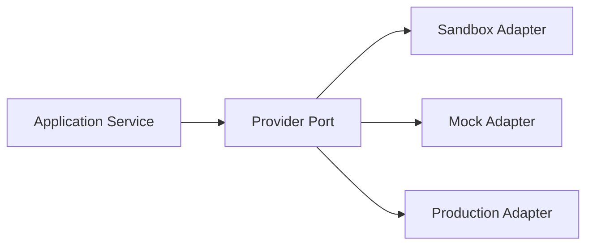

# Integration Architecture

## Adapter Pattern

All third parties implement a port interface + at least one of: `SandboxAdapter`, `MockAdapter`, `ProductionAdapter`.

## Payment Gateway

- Responsibilities: create QR/intent, refund, verify webhook  
- Inbound: signed webhooks only on dedicated routes  
- Outbound: idempotent create with platform intent id as merchant reference  
- Status: **BLOCKED for production** until licensed credentials provided  

## OCR / KYC Assist

- Optional enhancement over manual review  
- Never sole authority for KYC approval  
- Status: mock until vendor selected  

## E-Signature

- Create signing session, receive completion webhook, store evidence artifact refs  
- Contract PDF/hash retained with version  
- Status: mock until provider selected  

## Android Device Channel

- Enrollment: Android Enterprise **QR** (6-tap) as default counter path; Zero-touch evaluated in DM0; NFC out of pilot unless proven  
- Management: **pending DM0** — Android Management API, custom Device Owner DPC, or hybrid. Phase 0 assumed custom Kotlin DPC; that remains a valid prototype path  
- DPC or AMAPI agent authenticates as device agent after consuming a short-lived enrollment token  
- Heartbeat + command poll/push (FCM)  
- WorkManager for offline sync  
- QR extras must not include Wi-Fi passwords or private keys  
- Play Protect disable is **not** an integration requirement  
- Status: **BLOCKED for production** until DM0 hardware evidence  

## iOS MDM

- Via approved MDM provider or properly designed MDM server (`MdmProviderPort`)  
- Apple Business Manager + supervision (Configurator on iPhone/Mac and/or ADE) required for the retail flow observed in reference materials  
- Ownership **Model A (platform ABM)** vs **Model B (merchant ABM)** is **pending** — see [../device-management/TENANT-OWNERSHIP-MODELS.md](../device-management/TENANT-OWNERSHIP-MODELS.md)  
- APNs for wake; check-in protocol behind adapter  
- Capability matrix gates commands  
- Do not require skipping Apple ID / passcode / Location Services  
- Status: **BLOCKED for production** until MDM test environment **and** Apple program eligibility evidence   

## Notifications

| Channel | Adapter | Pilot note |
|---------|---------|------------|
| Push | FCM/APNs | R3 |
| SMS | Thai SMS provider | consent required |
| Email | SMTP/API | transactional |
| LINE | LINE Messaging API | consent required |

## Failure Handling

- Retries with backoff via BullMQ  
- Poison messages to dead-letter + alert  
- Provider outages surface as degraded mode, not silent success  
