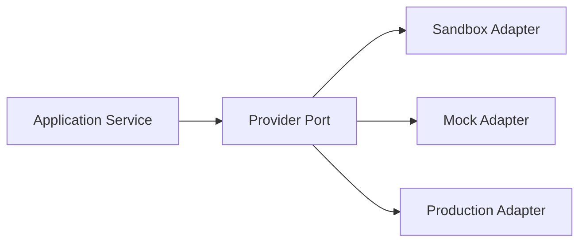

# Integration Architecture

## Adapter Pattern

All third parties implement a port interface + at least one of: `SandboxAdapter`, `MockAdapter`, `ProductionAdapter`.

## Payment Gateway

- Responsibilities: create QR/intent, refund, verify webhook  
- Inbound: signed webhooks only on dedicated routes  
- Outbound: idempotent create with platform intent id as merchant reference  
- Status: **BLOCKED for production** until licensed credentials provided  

## OCR / KYC Assist

- Optional enhancement over manual review  
- Never sole authority for KYC approval  
- Status: mock until vendor selected  

## E-Signature

- Create signing session, receive completion webhook, store evidence artifact refs  
- Contract PDF/hash retained with version  
- Status: mock until provider selected  

## Android Device Channel

- DPC authenticates as device agent  
- Heartbeat + command poll/push (FCM)  
- WorkManager for offline sync  

## iOS MDM

- Via approved MDM provider or properly designed MDM server  
- APNs for wake; check-in protocol behind adapter  
- Capability matrix gates commands  
- Status: **BLOCKED for production** until MDM test environment available  

## Notifications

| Channel | Adapter | Pilot note |
|---------|---------|------------|
| Push | FCM/APNs | R3 |
| SMS | Thai SMS provider | consent required |
| Email | SMTP/API | transactional |
| LINE | LINE Messaging API | consent required |

## Failure Handling

- Retries with backoff via BullMQ  
- Poison messages to dead-letter + alert  
- Provider outages surface as degraded mode, not silent success  
