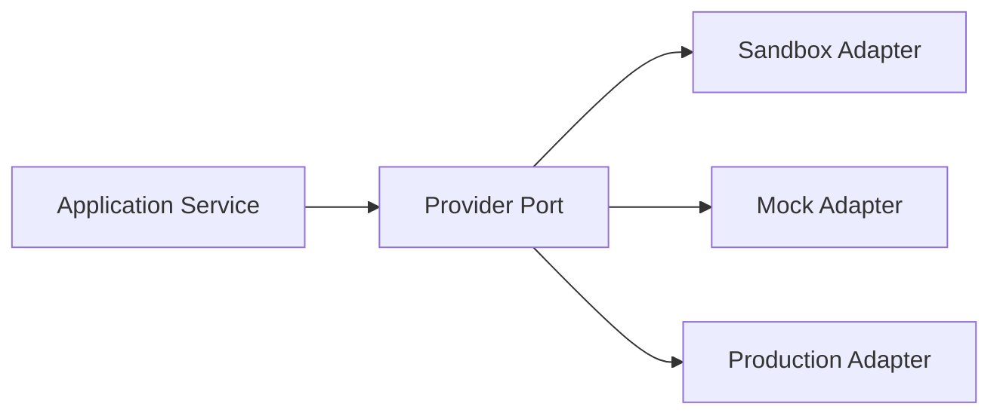

# Integration Architecture

## Adapter Pattern

All third parties implement a port interface + at least one of: `SandboxAdapter`, `MockAdapter`, `ProductionAdapter`.

## Payment Gateway

- Responsibilities: create QR/intent, refund, verify webhook  
- Inbound: signed webhooks only on dedicated routes  
- Outbound: idempotent create with platform intent id as merchant reference  
- Status: **BLOCKED for production** until licensed credentials provided  

## OCR / KYC Assist

- Optional enhancement over manual review  
- Never sole authority for KYC approval  
- Status: mock until vendor selected  

## E-Signature

- Create signing session, receive completion webhook, store evidence artifact refs  
- Contract PDF/hash retained with version  
- Status: mock until provider selected  

## Android Device Channel

- Enrollment: **custom DPC Enterprise QR** (6-tap) default (D-057); **Zero-touch** when reseller pre-registered the IMEI (D-049); NFC out of pilot  
- Management: native Kotlin DPC + `DevicePolicyManager` (Device Owner). AMAPI is not the lock engine (D-054)  
- DPC authenticates with a short-lived enrollment token, then a device JWT  
- Heartbeat + command poll/push (FCM)  
- WorkManager for offline sync  
- QR extras must not include Wi-Fi passwords or private keys  
- Play Protect disable is **not** an integration requirement  
- Status: **BLOCKED for production** until Phase 2–7 evidence  

## iOS MDM

- Via approved MDM provider or properly designed MDM server (`MdmProviderPort`)  
- Apple Business Manager + supervision (Configurator on iPhone/Mac and/or ADE) required for the retail flow observed in reference materials  
- Ownership **Model B (merchant ABM)** + vendor MDM (D-043) — see [../device-management/TENANT-OWNERSHIP-MODELS.md](../device-management/TENANT-OWNERSHIP-MODELS.md)  
- APNs for wake; check-in protocol behind adapter  
- Capability matrix gates commands  
- Do not require skipping Apple ID / passcode / Location Services  
- Financing lock mechanism: supervised **Single App Mode** (D-056), not Lost Mode and not DeviceLock-as-collections  
- Customer Flutter app is UI + payment status only until MDM ack updates `osEnforcement`  
- Status: **BLOCKED for production** until MDM test environment **and** Apple program eligibility evidence   

## Notifications

| Channel | Adapter | Pilot note |
|---------|---------|------------|
| Push | FCM/APNs | R3 |
| SMS | Thai SMS provider | consent required |
| Email | SMTP/API | transactional |
| LINE | LINE Messaging API | consent required; due/overdue reminders and payment confirmations |

The LINE pilot uses a merchant-owned Official Account. Customers explicitly link
their account after customer OTP authentication and can unlink in-app, send
`STOP`, or unfollow the Official Account. The worker sends a due reminder one
day before the due date, one overdue reminder the day after, and a payment
confirmation only after a verified payment webhook. Messages do not include
balances or identity data. Channel credentials are encrypted at rest; webhook
signatures are verified and delivery uses a database outbox with retries. Chat
support, slip uploads, merchant onboarding UI, and production credential
approval are not included.

To configure a merchant, an owner posts the Official Account channel access
token, channel secret, and HTTPS Official Account URL to
`POST /api/v1/tenants/me/line-integration`; the access token is checked against
LINE before storage, and the response includes that tenant's webhook URL. Set
the LINE Developers webhook URL to the returned URL.
Customers use `GET/POST/DELETE /api/v1/me/line-link`; after consenting in the
customer app, they send the returned `LINK <code>` command to the merchant's
Official Account. `LINE_CREDENTIALS_ENCRYPTION_KEY` must be a dedicated secret
of at least 32 characters, and `PUBLIC_API_BASE_URL` must be the public API
origin reachable by LINE over HTTPS.

## Failure Handling

- Retries with backoff via BullMQ  
- Poison messages to dead-letter + alert  
- Provider outages surface as degraded mode, not silent success  
