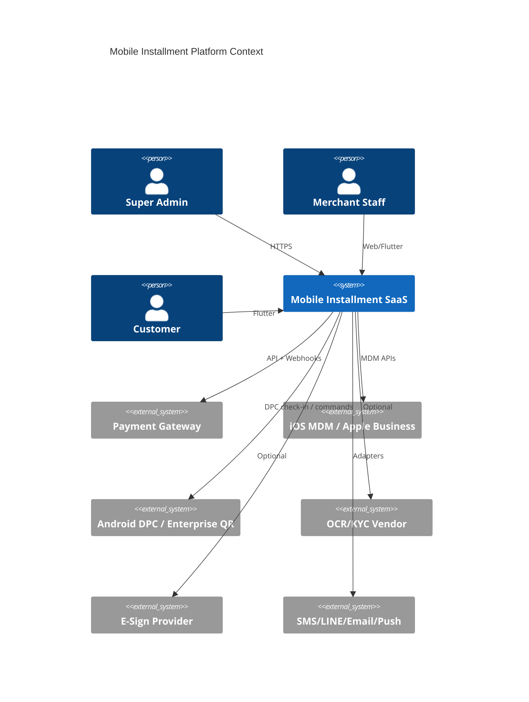
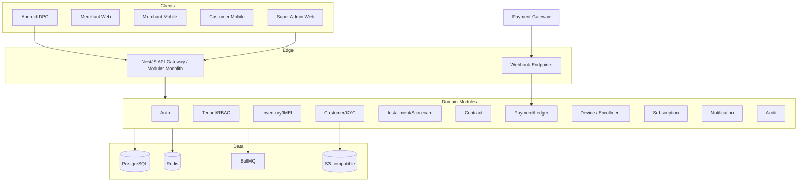

# System Architecture (Phase 0 Draft)

## Style

**Modular monolith** backend first. Extract services only when module boundaries and load demand it.

## Context Diagram

## Logical Architecture

## Module List

1. Auth  
2. Tenant  
3. Subscription  
4. Merchant  
5. Branch  
6. User  
7. Role & Permission  
8. Customer  
9. KYC  
10. Product  
11. Inventory  
12. Installment  
13. Contract  
14. Payment  
15. Ledger  
16. Collection  
17. Device Management (registry, enrollment, provisioning, activation, bind, policy, commands, heartbeat, recovery)  
18. Notification  
19. Reporting  
20. Audit Log  

## Key Flows

### Payment

Customer → Payment Intent → Gateway → Webhook → Verify → Transaction → Ledger → Allocation → Schedule → Notification → (optional) Device recovery evaluation

### Device Command

Authorized actor/policy → Command record → Queue → Device pull/push → Execute → Ack/result → Audit  
Success of HTTP create ≠ device executed.

### Device Enrollment

Staff wizard → Enrollment session (TTL token) → Android QR **or** iOS Configurator/ADE instructions → OS provisioning → Agent/MDM check-in → Verify identity → Activate → Bind contract → Level 1 policy.  
Details: [../device-management/DEVICE-PROVISIONING-ENROLLMENT.md](../device-management/DEVICE-PROVISIONING-ENROLLMENT.md). Android = custom DPC QR (D-057); iOS = Model B (D-043). Production claims remain evidence-gated.

## Cross-Cutting

- OpenAPI/Swagger for all public HTTP APIs  
- Structured logging with PII redaction  
- OpenTelemetry hooks prepared for later Grafana stacks  
- Config via environment variables; `.env.example` only  

## Non-Goals of This Draft

Final deployment topology (K8s vs VM), exact MDM vendor, and exact payment vendor selection remain adapter-level decisions recorded in the Decision Log when chosen.
