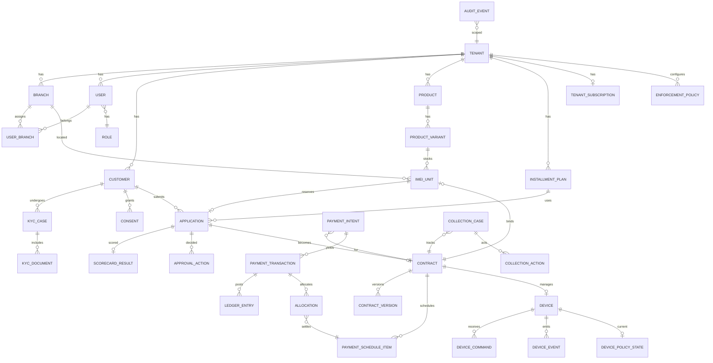

# Initial ERD (Phase 0)

Logical ERD — not final physical schema. UUIDs omitted in diagram labels for readability.

## Domain Model Notes

- `ENFORCEMENT_POLICY` stores preset reference + per-level thresholds and approval flags.  
- `DEVICE_POLICY_STATE.level` ∈ {1..5}.  
- `INSTALLMENT_PLAN.interest_method` ∈ {`FLAT`,`REDUCING`}.  
- `SCORECARD_RESULT` informs humans; does not auto-activate contracts.  
- SaaS `TENANT_SUBSCRIPTION` tables are separate from installment `LEDGER_ENTRY` streams (tag `ledger_domain = SAAS|INSTALLMENT`).  
