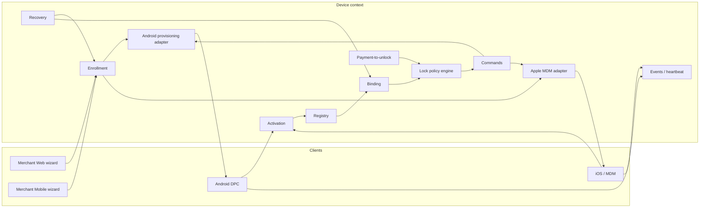

# Device Provisioning & Enrollment Platform

Expands Phase 0 “Device Control” from registry + commands into a full **provisioning, enrollment, activation, bind, policy, heartbeat, recovery** lifecycle.

Related: [ANDROID-ENROLLMENT.md](./ANDROID-ENROLLMENT.md), [IOS-ENROLLMENT.md](./IOS-ENROLLMENT.md), [TENANT-OWNERSHIP-MODELS.md](./TENANT-OWNERSHIP-MODELS.md), [../api/DEVICE-ENROLLMENT-API.md](../api/DEVICE-ENROLLMENT-API.md).

## Confirmed vs assumed

| Confirmed requirements | Assumptions / pending |
|------------------------|----------------------|
| Android **custom DPC + QR Device Owner** (D-057); iOS Model B (D-043); mandatory enroll (D-050) | 6-tap QR on every target OEM; Play/custom DPC commercial eligibility |
| Short-lived enrollment sessions; hashed tokens | Exact MDM vendor SKU |
| No secrets in QR; no Play Protect-off SOP | Min OS / SKU matrix (lab) |
| Consent captured; legal **wording** later (D-051) | IMEI vs hardware fingerprint as bind key |
| One active contract binding per device/IMEI | Zero-touch / OEM FRP exemption (optional); wipe re-enroll SOP: [FRP-AND-REENROLL.md](./FRP-AND-REENROLL.md) |
| Audit all restrict / enroll / unenroll | Hardware proof for production |
| Emergency calling; no stealth; no Lost Mode collections | AMAPI EMI exception (D-054) — not required for DPC prototype |
| Business lock state ≠ platform state | — |

## Logical modules (NestJS domains, not microservices)

Keep a single **Device** bounded context (`DEVICE_CONTROL`) with application services below. Do not spawn new deployables in R2. Do not mix Android `DevicePolicyManager` semantics with Apple MDM commands in one class.

| Module | Responsibility |
|--------|----------------|
| **Device Registry** | Inventory of managed devices: platform, identifiers, ownership, lifecycle status |
| **Enrollment Management** | Sessions, tokens, QR material, expiry, status, verify, cancel, retry |
| **Android Provisioning Adapter** | DPC QR JSON, checksum, token bind; DPC command envelopes |
| **Apple MDM Adapter** | `MdmProviderPort` only — Configurator/ADE instructions, SAM commands |
| **Device Activation** | First registration after OS enroll, merchant + customer association |
| **Device Contract Binding** | Active bind/unbind to installment contract; history; IMEI consistency |
| **Device Lock Policy Engine** | Shared desired presentation (`REMINDER`/`RESTRICT`/`LOCK`) mapped to levels 1–5 |
| **Device Command Management** | Authorized commands, status, retry, expiry, execution events |
| **Device Events** | Check-in, connectivity, status, history |
| **Device Recovery** | Failed enroll, reassignment, replacement, release, unenroll, termination |
| **Payment-to-Unlock Orchestrator** | Verified payment events → unlock/step-down commands via the correct adapter |

**Provisioning Management** remains versioned `device_provisioning_profiles` (Android extras / iOS instruction templates). AMAPI may exist later as an optional `AndroidEnterprisePort`; it is not the lock adapter.

Payment still **must not** call these modules except via **verified domain events**.



## Enrollment session state machine

```text
NOT_STARTED → WAITING_FOR_DEVICE → QR_GENERATED → PROVISIONING → ENROLLING
    → VERIFYING → ACTIVATING → COMPLETED
Any non-terminal → FAILED | EXPIRED | CANCELLED | RECOVERY_REQUIRED
COMPLETED → (later) UNENROLLED | REPLACED via recovery
```

| State | Meaning |
|-------|---------|
| `NOT_STARTED` | Session created; no material issued |
| `WAITING_FOR_DEVICE` | Staff in wizard; waiting to generate QR or confirm iOS host ready |
| `QR_GENERATED` | Enrollment material issued (Android QR **or** iOS instruction pack + optional shop code). Poll for check-in |
| `PROVISIONING` | OS setup in progress (best-effort; may skip if we only see check-in) |
| `ENROLLING` | DPC/MDM registered with platform or vendor |
| `VERIFYING` | Identity vs inventory/IMEI |
| `ACTIVATING` | Customer/merchant association in progress |
| `COMPLETED` | Bound (or explicitly unbound wait — still enrolled) per API |
| `FAILED` | Terminal failure with error code |
| `EXPIRED` | TTL passed; token dead |
| `CANCELLED` | Staff cancel |
| `RECOVERY_REQUIRED` | Partial enroll (e.g. DO installed, bind failed) |

Idempotent transitions. Duplicate check-ins do not create duplicate devices.

## Merchant Enrollment Wizard

Surfaces: **Merchant Web (R2)** and **Merchant Mobile (R2)**. Customer app only shows **device status** (CM-08), not enrollment.

Flow:

1. Select customer (KYC as required by contract rules).  
2. Select installment contract (`ACTIVE`, same tenant/branch as authorized).  
3. Confirm device-management **consent** (timestamp, version of disclosure).  
4. Select Android or iOS.  
5. Start enrollment session (`NOT_STARTED` / `WAITING_FOR_DEVICE`).  
6. Generate Android QR **or** show iOS Configurator / Apple Business instructions (`QR_GENERATED`). Platform-specific copy only.  
7. Monitor progress (`PROVISIONING` → `ENROLLING`; poll with backoff).  
8. Verify device identity (IMEI/serial vs reserved `ImeiUnit`).  
9. Activate.  
10. Bind contract (may be combined with activate if idempotent).  
11. Confirm `COMPLETED`; handover unlocked. Desired lock remains `NONE`.

Dashboard after enroll: [MERCHANT-DEVICE-DASHBOARD.md](./MERCHANT-DEVICE-DASHBOARD.md).

### iOS wizard prerequisites (block start if unmet)

- Tenant MDM account status `CONNECTED` (Model B).  
- Staff acknowledgement: Configurator host ready, target iPhone erased/new, ABM authorized.  
- Do not tell staff to skip passcode, Apple ID, or Location Services.

### Android wizard prerequisites

- Target new or factory-reset.  
- 6-tap QR instructions.  
- Wi-Fi available **on the device**.  
- Never instruct Play Protect off as a required step.

## Security requirements (enrollment)

- Consent + role: `MERCHANT_OWNER` / `MERCHANT_MANAGER` / granted enroll permission; branch scope.  
- Tokens: CSPRNG, SHA-256 hash at rest, shown once, TTL, rotate on retry.  
- Rate-limit session create and `activate` / shop-code guesses.  
- Device agent auth: enrollment token then device credential (mTLS or device JWT audience `device-agent`).  
- Webhooks from MDM (and AMAPI if ever enabled): signature verify + idempotency (`provider_event_id`). DPC check-in uses enrollment token, not an unverified webhook.  
- Bind requires session `VERIFYING`/`ACTIVATING` and matching IMEI; reject if another ACTIVE contract bound.  
- Restrictive commands: existing reason + authz + expiry + audit.  
- Recovery/unenroll audited; factory reset not used as collections.  
- No covert surveillance APIs (no silent mic/camera/keylog). Heartbeat is connectivity + policy compliance + inventory identifiers only.

## Duplicate and replacement

- Same IMEI re-enroll: recover session or `device_recovery_requests` type `REENROLL`.  
- Replacement phone: unbind old, unenroll per policy, new session, bind same contract.  
- Contract close: policy relax + optional unenroll (J7).
