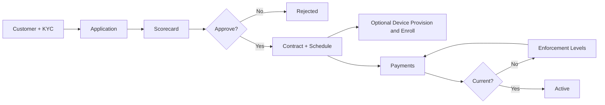

# User Journeys

## J1 — Merchant Onboarding (Platform → Tenant)

1. Merchant applies / Super Admin creates tenant  
2. Subscription plan assigned; entitlements set (branches, employees, contracts, devices)  
3. Owner completes merchant profile and first branch  
4. Owner invites employees and assigns roles/branches  
5. Owner configures installment plans (terms, flat/reducing, fees)  
6. Owner configures device enforcement preset + custom thresholds  
7. Merchant verified → tenant ACTIVE  

**Outcome:** Tenant can sell installments under policy.

## J2 — Customer Registration & KYC

1. Staff opens Merchant App/Web → Customer Registration  
2. Capture identity (Thai National ID), contacts, consent  
3. Upload/capture KYC documents; optional OCR assist  
4. Customer may continue KYC in Customer App via OTP login  
5. KYC_REVIEWER reviews → APPROVED / REJECTED / NEEDS_RESUBMIT  
6. Audit trail stored; sensitive fields masked in logs  

**Outcome:** Customer KYC status usable for applications.

## J3 — Sale → Application → Scorecard → Approval

1. Staff selects customer (KYC approved)  
2. Search product / scan IMEI; reserve stock  
3. Installment calculator: price, down payment, term, plan formula  
4. Submit application; scorecard computes risk score + reasons  
5. CREDIT_OFFICER / authorized role approves or rejects  
6. On approve: down payment intent created if required  

**Outcome:** Approved application ready for contract; IMEI remains reserved.

## J4 — Contract & Device Binding

1. Generate contract from approved application (versioned)  
2. Customer e-signs (adapter) + staff countersign as required  
3. Activate contract; bind IMEI; convert reservation → sold  
4. Generate payment schedule (decimal-safe; flat or reducing)  
5. If device management enabled: **J4b enrollment** (below)  
6. Device starts at Level 1 (normal) after successful bind  

**Outcome:** Active contract + schedule + optional device binding.

## J4b — Device Provisioning & Enrollment (R2)

Staff wizard (Merchant Web or Merchant Mobile). Details: [../device-management/DEVICE-PROVISIONING-ENROLLMENT.md](../device-management/DEVICE-PROVISIONING-ENROLLMENT.md).

**Android (target):** consent → session → QR (no secrets) → factory-reset/new device → 6-tap scan → Wi-Fi on device → Enterprise/DO provision → verify IMEI → activate → bind. **Do not** require Play Protect off.

**iOS (target):** ABM/MDM prerequisites → session + instructions (optional shop code) → Configurator (iPhone or Mac) or ADE → Remote Management → standard Setup Assistant (passcode/Apple ID/location not force-skipped) → MDM check-in → activate → bind.

Session states: Not Started, Waiting for Device, Provisioning, Enrolling, Verifying, Activating, Completed, Failed, Expired, Cancelled, Recovery Required.

**Mandatory (D-050):** customer does not leave with the phone until enrollment `COMPLETED`. Unsupported Android SKU → cannot sell installment (D-052). Wireframes: [../device-management/ENROLLMENT-WIZARD-MOCKUP.md](../device-management/ENROLLMENT-WIZARD-MOCKUP.md).

**Not shown in competitor videos:** overdue locking. That remains J6.

## J5 — Customer Payment (PromptPay)

1. Customer opens contract → Pay / Payment QR  
2. System creates Payment Intent (idempotent key)  
3. Gateway returns PromptPay QR / deep link  
4. Customer pays; gateway webhook arrives  
5. Signature verified → Payment Transaction → Ledger → Allocation  
6. Schedule installment(s) updated; notification sent  
7. If enforcement was elevated and balance current → recovery policy may lower level  

**Outcome:** Outstanding balance correct; no duplicate allocation on replayed webhooks.

## J6 — Overdue & Graduated Enforcement

1. Scheduler marks installments overdue  
2. Level 2: warnings (push/SMS/LINE per consent)  
3. Per merchant policy: auto or human-gated transition to Levels 3–5  
4. Commands queued to device with reason, actor, expiry  
5. Device acks execution asynchronously; status reconciled  
6. Customer pays → authorized recovery unlock path  

**Outcome:** Enforcement is policy-driven, auditable, recoverable; emergency calling remains available.

## J7 — Early Settlement / Closure

1. Customer or staff requests early settlement quote  
2. System calculates remaining principal/fees per plan rules  
3. Payment collected; contract CLOSED  
4. Device policies relaxed / unenrolled per policy  
5. IMEI contract binding ended; history retained  

## J8 — Super Admin Tenant Ops

1. View global dashboard  
2. Verify/suspend tenant; manage packages  
3. Inspect audit/security events  
4. SaaS invoice cycle separate from customer installment money  

## Journey Diagram (Core Sale)

