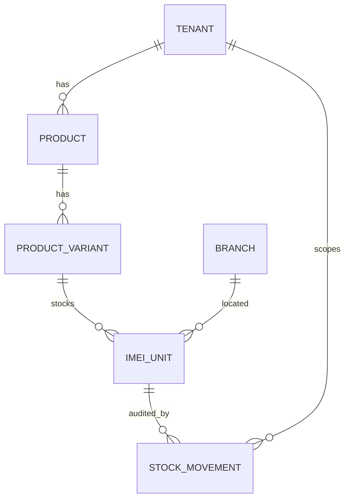

# R1a Inventory + Product + IMEI Design

**Date:** 2026-11-12  
**Status:** Approved for documentation (awaiting user review of this file)  
**Parent:** R1 Installment Core (sliced; R1a is first sub-project)  
**Depends on:** R0 Foundation (auth, tenant, branch, Prisma)

## Decisions

| ID | Decision |
|----|----------|
| D-011 | Start R1 as sub-slices; first slice is R1a Inventory/IMEI |
| D-012 | IMEI unique per tenant `(tenant_id, imei)` |
| D-013 | Every IMEI belongs to exactly one branch; transfers via stock movements |
| D-014 | Catalog: Product → Variant (color/storage) → ImeiUnit |
| D-015 | IMEI statuses in R1a: AVAILABLE, RESERVED, SOLD, TRANSFERRED_OUT |
| D-016 | R1a is backend API only (no Merchant Web / Flutter in this slice) |
| D-017 | Approach: full Nest inventory domain module (not schema-only) |

## Goal

Enable a merchant tenant to manage products, variants, and branch-scoped IMEI inventory with audited stock movements and reservation support that later installment flows can consume without schema rework.

## Non-Goals

- Merchant Web / Flutter UI  
- Application, contract, payment domains  
- Full RBAC permission matrix (use authenticated tenant members)  
- OCR / hardware scanner SDKs  
- Cross-tenant IMEI uniqueness  

## Domain Model

### Product
- `id`, `tenantId`, `name`, `brand` (string), `status` (ACTIVE/INACTIVE), timestamps  
- Unique optional later: `(tenantId, name)` not required in R1a  

### ProductVariant
- `id`, `tenantId`, `productId`, `sku`, `color`, `storage`, `price` DECIMAL(18,2), `currency` default THB, `status`  
- Unique: `(tenantId, sku)`  

### ImeiUnit
- `id`, `tenantId`, `branchId`, `variantId`, `imei`, `status`  
- Unique: `(tenantId, imei)`  
- Status: `AVAILABLE` | `RESERVED` | `SOLD` | `TRANSFERRED_OUT`  

### StockMovement (append-only)
- `id`, `tenantId`, `imeiUnitId`, `type`, `fromBranchId?`, `toBranchId?`, `actorUserId`, `reason?`, `createdAt`  
- Types: `RECEIVE` | `TRANSFER` | `RESERVE` | `RELEASE` | `SELL` | `ADJUST`  

## State Transitions

| From | Action | To | Notes |
|------|--------|-----|-------|
| — | RECEIVE | AVAILABLE | Creates ImeiUnit at branch |
| AVAILABLE | RESERVE | RESERVED | Blocks another reserve/sell |
| RESERVED | RELEASE | AVAILABLE | Cancel application later |
| RESERVED | SELL | SOLD | Used by R1d; exposed as service method in R1a |
| AVAILABLE | TRANSFER | AVAILABLE | Same status; branch changes; movement TRANSFER |
| AVAILABLE | (soft exit) | TRANSFERRED_OUT | Optional if leaving tenant inventory permanently — prefer TRANSFER between branches; TRANSFERRED_OUT reserved for leave-network cases |

Double-reserve of the same unit must fail. Duplicate IMEI receive in the same tenant must fail with conflict.

## API Surface (`/api/v1`)

All routes require JWT. `tenantId` from auth context only.

| Method | Path | Purpose |
|--------|------|---------|
| POST | `/products` | Create product |
| GET | `/products` | List products (paginated) |
| GET | `/products/:id` | Get product |
| PATCH | `/products/:id` | Update product |
| POST | `/products/:id/variants` | Create variant |
| GET | `/products/:id/variants` | List variants |
| POST | `/inventory/imeis/receive` | Receive IMEI into branch |
| GET | `/inventory/imeis` | Search/list (imei, branchId, status) |
| GET | `/inventory/imeis/:id` | Get unit |
| POST | `/inventory/imeis/:id/transfer` | Transfer to another branch |
| POST | `/inventory/imeis/:id/reserve` | Reserve |
| POST | `/inventory/imeis/:id/release` | Release reservation |
| GET | `/inventory/movements` | List movements for unit/branch |

Money fields: DECIMAL string in JSON (e.g. `"12900.00"`), never float.

## Authorization

- Authenticated user with `tenantId` matching resource tenant  
- `branchId` in body must belong to same tenant  
- Super Admin not required for R1a merchant inventory  
- Full permission codes deferred to later RBAC work  

## Architecture Placement

NestJS modules under `backend/src/`:

- `catalog/` — Product, ProductVariant  
- `inventory/` — ImeiUnit, StockMovement, receive/transfer/reserve/release/sell  

Use Prisma transactions for receive, transfer, reserve, release, sell. Controllers thin; services enforce status rules.

## Testing Requirements

- Unit: status transition guards, duplicate IMEI rejection  
- Integration/e2e: receive → transfer → reserve → release  
- Isolation: tenant A cannot read/write tenant B inventory  
- Conflict: second reserve on RESERVED unit fails  

## Acceptance Criteria

1. Merchant can create product + variant with decimal price  
2. Merchant can receive IMEI into a branch  
3. Duplicate IMEI in same tenant returns conflict  
4. Transfer moves branch and writes TRANSFER movement  
5. Reserve/release work; double-reserve fails  
6. Cross-tenant access denied  
7. No Merchant Web required for R1a exit  

## Follow-on Slices

- R1b Customer + KYC  
- R1c Application + Scorecard  
- R1d Contract + Schedule  
- R1e PromptPay sandbox  
- R1f Merchant Web + Customer App critical flows  
