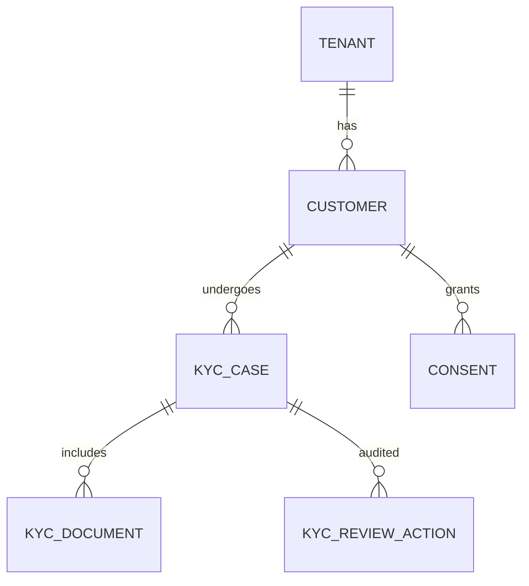

# R1b Customer + KYC Design

**Date:** 2026-11-12  
**Status:** Approved — implementation plan ready  
**Parent:** R1 Installment Core  
**Depends on:** R0 Foundation, R1a Inventory (no hard code dependency; sequential delivery)

## Decisions

| ID | Decision |
|----|----------|
| D-019 | National ID stored encrypted at rest + hash for lookup; never plain text in DB/API lists/logs |
| D-020 | OCR via `OcrProviderPort` + Sandbox/Mock adapter until production credentials exist |
| D-021 | Customer phone unique per tenant |
| D-022 | R1b approach: Customer + KYC case + documents + OCR port + manual staff review; backend API only |
| D-023 | Object storage behind `ObjectStoragePort`; local/filesystem or mock adapter acceptable for R1b |

## Goal

Enable merchants to register customers, capture consents, collect KYC documents, run sandbox OCR assist, and complete staff review so R1c applications can require an APPROVED KYC case.

## Non-Goals

- Merchant Web / Flutter UI  
- Credit scorecard / applications (R1c)  
- Production OCR vendor binding without credentials  
- Full PDPA deletion workflow automation (document hooks only)  
- Full RBAC permission matrix (authenticated tenant members; review by OWNER/STAFF roles)

## Domain Model

### Customer
- `id`, `tenantId`, `fullName`, `phone`, `nationalIdEncrypted`, `nationalIdHash`, `status` (ACTIVE/DISABLED), timestamps  
- Unique: `(tenantId, phone)`  
- Index: `(tenantId, nationalIdHash)` for lookup (not necessarily unique in R1b)

### KycCase
- `id`, `tenantId`, `customerId`, `status`, `ocrProvider`, `ocrSummaryJson` (safe fields only — no raw ID number), timestamps  
- Status: `DRAFT` | `SUBMITTED` | `IN_REVIEW` | `APPROVED` | `REJECTED` | `NEEDS_RESUBMIT`  
- At most one **open** case per customer preferred (service rule); historical cases retained

### KycDocument
- `id`, `tenantId`, `kycCaseId`, `type` (`ID_FRONT` | `ID_BACK` | `SELFIE` | `OTHER`), `storageKey`, `mimeType`, `checksum?`, `uploadedByUserId`, `createdAt`

### Consent
- `id`, `tenantId`, `customerId`, `type` (e.g. `PDPA_PROCESSING`, `MARKETING`), `version`, `grantedAt`, `revokedAt?`

### KycReviewAction (append-only)
- `id`, `tenantId`, `kycCaseId`, `actorUserId`, `decision` (`APPROVE` | `REJECT` | `REQUEST_RESUBMIT`), `reason?`, `createdAt`

## State Transitions

| From | Action | To |
|------|--------|-----|
| — | create case | DRAFT |
| DRAFT | upload docs + submit | SUBMITTED |
| SUBMITTED | run OCR / staff open | IN_REVIEW |
| IN_REVIEW | approve | APPROVED |
| IN_REVIEW | reject | REJECTED |
| IN_REVIEW | request resubmit | NEEDS_RESUBMIT |
| NEEDS_RESUBMIT | submit again | SUBMITTED |

OCR failure does not auto-reject; staff can still review manually.

## Ports

### OcrProviderPort
- `analyzeIdDocuments(input): Promise<OcrSandboxResult>`  
- Sandbox returns plausible structured fields (name confidence, document present flags) **without requiring real vendor credentials**  
- Production adapter marked BLOCKED until credentials supplied  

### ObjectStoragePort
- `putObject`, `getSignedDownloadUrl` (or local path equivalent)  
- Keys prefixed by `tenantId` / `customerId` / `caseId`  
- Never expose another tenant’s keys  

### NationalIdCrypto
- `encrypt(plain)`, `hash(plain)` using env-backed key (`NATIONAL_ID_ENCRYPTION_KEY`)  
- Hash: keyed HMAC-SHA256 for lookup stability  

## API Surface (`/api/v1`)

| Method | Path | Purpose |
|--------|------|---------|
| POST | `/customers` | Register customer + optional consents |
| GET | `/customers` | List (masked ID) |
| GET | `/customers/:id` | Detail (masked or last-4 only) |
| PATCH | `/customers/:id` | Update non-sensitive / re-encrypt ID if provided |
| POST | `/customers/:id/kyc-cases` | Create DRAFT case |
| POST | `/kyc-cases/:id/documents` | Register upload + store object |
| POST | `/kyc-cases/:id/submit` | DRAFT/NEEDS_RESUBMIT → SUBMITTED |
| POST | `/kyc-cases/:id/ocr` | Run sandbox OCR → IN_REVIEW |
| POST | `/kyc-cases/:id/review` | Staff decision |
| GET | `/kyc-cases/:id` | Case + docs metadata |

All routes: JWT; `tenantId` from auth only.

## Security & Privacy

- No national ID plain text in logs, list APIs, or OCR summary JSON  
- Document bytes not logged  
- Cross-tenant access denied  
- Encryption key only via env / secret manager  

## Testing Requirements

- Duplicate phone → 409  
- Cross-tenant customer/KYC deny  
- Encrypt/hash behavior unit-tested (no plain stored on create)  
- OCR port called with sandbox adapter  
- Review transitions audited  
- Invalid status transitions → conflict  

## Acceptance Criteria

1. Merchant can create customer with unique phone  
2. National ID stored encrypted + hashed; lists do not show full plain ID  
3. KYC case can collect documents and submit  
4. Sandbox OCR runs through port  
5. Staff can approve/reject/request resubmit with audit  
6. Cross-tenant isolation tests pass  
7. No UI apps required for R1b exit  

## Follow-on

- R1c Application + Scorecard (requires APPROVED KYC)  
- Production OCR adapter when credentials available  
