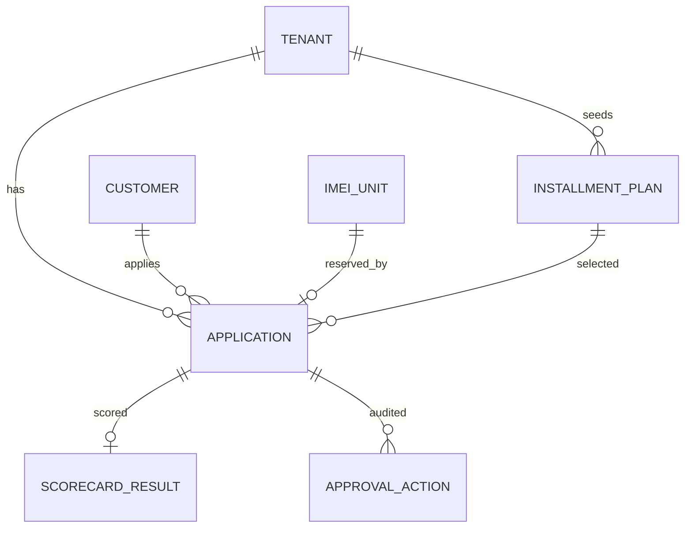

# R1c Application + Scorecard Design

**Date:** 2026-11-12  
**Status:** Approved — awaiting implementation plan  
**Parent:** R1 Installment Core  
**Depends on:** R0 Foundation, R1a Inventory (reserve/release), R1b Customer + KYC (APPROVED case required)

## Decisions

| ID | Decision |
|----|----------|
| D-024 | R1c backend Application + Scorecard only; InstallmentPlan is seed/read-only (no Plan CRUD API/UI) |
| D-025 | Scorecard is a versioned hardcoded pure function (`r1c-v1`); advisory only — merchant still approves/rejects |
| D-026 | Application submit reserves IMEI; reject/cancel releases; APPROVED keeps RESERVED until R1d contract |
| D-027 | Application decisions allowed for `MERCHANT_OWNER` / `MERCHANT_STAFF` (CREDIT_OFFICER deferred with full RBAC) |

## Goal

Enable merchants to create installment applications against an APPROVED KYC customer and AVAILABLE IMEI, compute an advisory risk scorecard, and record immutable approve/reject decisions so R1d can generate contracts from APPROVED applications.

## Non-Goals

- InstallmentPlan CRUD / merchant plan builder  
- Contract generation, payment schedules, interest schedule math (R1d)  
- PromptPay / payments (R1e)  
- Merchant Web / Flutter UI (R1f)  
- External credit bureau adapters  
- Full RBAC / `CREDIT_OFFICER` role enforcement matrix  
- Down-payment intent / payment capture on approve  

## Domain Model

### InstallmentPlan (seeded, read-only in R1c)

- `id`, `tenantId`, `code`, `name`, `interestMethod` (`FLAT` | `REDUCING`), `annualRate` DECIMAL, `termMonths` int (or term options JSON if multiple), `feesJson` optional, `active` bool, timestamps  
- Seeded on tenant `register-owner` (1–2 default plans)  
- API: list active plans for tenant only — no create/update/delete in R1c  

### Application

- `id`, `tenantId`, `customerId`, `imeiUnitId`, `planId`  
- Money (DECIMAL): `principal`, `downPayment`  
- Snapshot fields copied at create/submit: `termMonths`, `interestMethod`, `annualRate` (immutable after submit)  
- `status`: `DRAFT` | `SUBMITTED` | `APPROVED` | `REJECTED` | `CANCELLED`  
- `submittedAt?`, `decidedAt?`, timestamps  
- Rules:
  - Customer must belong to tenant  
  - At most one **open** application (`DRAFT`/`SUBMITTED`) per `imeiUnitId`  
  - Submit requires customer to have a KYC case in `APPROVED`  

### ScorecardResult

- `id`, `tenantId`, `applicationId` (1:1)  
- `score` int 0–100  
- `band` `LOW` | `MEDIUM` | `HIGH`  
- `reasonsJson` string[] (machine-stable reason codes + human labels)  
- `version` e.g. `r1c-v1`  
- Created on submit; not silently overwritten (resubmit not in R1c — cancel + new application instead)  

### ApprovalAction (append-only)

- `id`, `tenantId`, `applicationId`, `actorUserId`  
- `decision` `APPROVE` | `REJECT`  
- `reason?`, `createdAt`  
- Written in the same DB transaction as status change  

## State Transitions

| From | Action | To | Side effects |
|------|--------|-----|--------------|
| — | create | DRAFT | none |
| DRAFT | submit | SUBMITTED | KYC gate; reserve IMEI; write ScorecardResult |
| DRAFT | cancel | CANCELLED | none |
| SUBMITTED | approve | APPROVED | ApprovalAction; IMEI stays RESERVED |
| SUBMITTED | reject | REJECTED | ApprovalAction; release IMEI → AVAILABLE |
| SUBMITTED | cancel | CANCELLED | release IMEI → AVAILABLE |

Invalid transitions → `409 Conflict`.

## Scorecard (`r1c-v1`)

Pure function — no I/O:

**Inputs:** `principal`, `downPayment`, `termMonths` (KYC approved is a hard gate before invoke).

**Example rules (implementation may tune weights; behavior must be unit-tested):**

1. Down-payment ratio = downPayment / principal  
2. Higher ratio → higher score; shortfall vs thresholds adds reasons  
3. Longer term reduces score past configured bands  
4. Output `{ score, band, reasons, version: "r1c-v1" }`  

Result is **advisory**. Approve/reject remains a human decision (D-007 / D-025).

## Inventory Integration

- On submit: call existing `InventoryService.reserve` with reason referencing application id  
- On reject/cancel (when previously reserved): call `InventoryService.release`  
- Prefer one transactional boundary where practical; if inventory + application cannot share one Prisma transaction easily, document ordering and compensating release on failure  
- Never mark IMEI `SOLD` in R1c (that is R1d contract activation)

## API Surface (`/api/v1`)

| Method | Path | Purpose |
|--------|------|---------|
| GET | `/installment-plans` | List seeded active plans |
| POST | `/applications` | Create DRAFT |
| GET | `/applications` | List (tenant scoped) |
| GET | `/applications/:id` | Detail + latest scorecard if any |
| POST | `/applications/:id/submit` | DRAFT → SUBMITTED |
| POST | `/applications/:id/decision` | APPROVE \| REJECT (+ reason?) |
| POST | `/applications/:id/cancel` | Cancel open application |

All routes: JWT; `tenantId` from auth only. Decision endpoints: OWNER/STAFF only.

## Security & Privacy

- No national ID or KYC document bytes in application logs  
- Cross-tenant access denied (404)  
- Approval audit immutable  
- Money fields Decimal-safe only  

## Testing Requirements

- Scorecard pure function unit suite (bands/reasons/version)  
- Submit without APPROVED KYC → 409  
- Submit reserves IMEI; reject/cancel releases to AVAILABLE  
- Decision + ApprovalAction atomic (transaction)  
- Illegal status transitions → 409  
- Cross-tenant e2e denial on GET application  
- Tenant A happy path: draft → submit → approve (IMEI remains RESERVED)

## Acceptance Criteria

1. New tenant receives seeded installment plans; list API works  
2. Application created only for in-tenant customer + IMEI + plan  
3. Submit blocked without APPROVED KYC  
4. Submit produces ScorecardResult and reserves IMEI  
5. Staff can approve/reject with audit; reject releases IMEI  
6. Cross-tenant isolation tests pass  
7. No UI / Plan CRUD / contract / payment claimed done  

## Follow-on

- R1d Contract + schedule (consume APPROVED application; SOLD IMEI)  
- Plan CRUD / merchant configuration later  
- CREDIT_OFFICER + full RBAC matrix  
- External bureau port (optional)  
