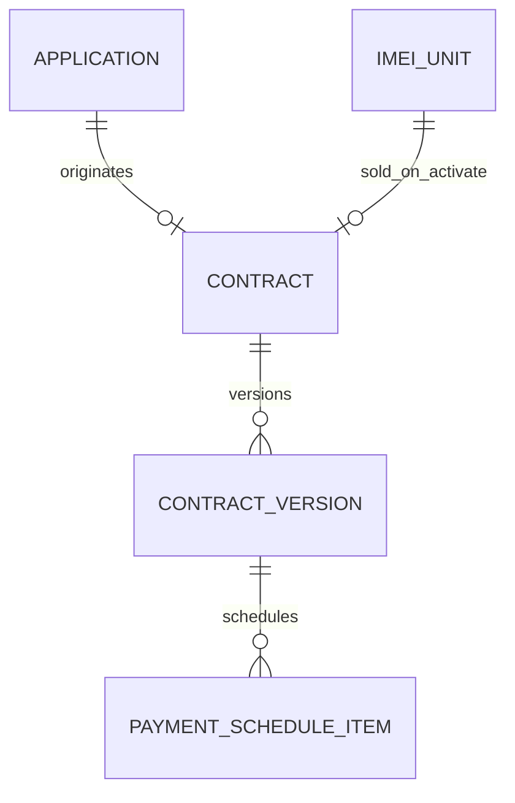

# R1d Contract + Schedule Design

**Date:** 2026-11-12  
**Status:** Approved — awaiting implementation plan  
**Parent:** R1 Installment Core  
**Depends on:** R0, R1a (IMEI reserve/`markSold`), R1b (KYC), R1c (APPROVED application + RESERVED IMEI)

## Decisions

| ID | Decision |
|----|----------|
| D-028 | R1d backend Contract + Schedule only; no e-sign, PDF, device bind, or payments |
| D-029 | Contract lifecycle DRAFT → ACTIVATE (IMEI SOLD); DRAFT may CANCEL without releasing IMEI |
| D-030 | Schedule engine `r1d-v1`: FLAT and REDUCING; THB 2dp round half-up; financed = principal − downPayment |
| D-031 | Activate performs contract status + IMEI SOLD + SELL movement in one DB transaction (no post-commit markSold) |

## Goal

Enable merchants to generate a versioned contract and repayment schedule from an APPROVED application, then activate the contract to mark the reserved IMEI as SOLD, unlocking R1e payments against schedule items.

## Non-Goals

- E-signature adapter / countersign  
- Contract PDF generation  
- Device enrollment / binding (R2)  
- Payment intents, webhooks, allocation (R1e)  
- Early settlement / restructuring  
- Plan CRUD / fee catalogs beyond fees=0  
- Merchant Web / Flutter UI  
- Full RBAC / CREDIT_OFFICER  

## Domain Model

### Contract

- `id`, `tenantId`, `applicationId`, `customerId`, `imeiUnitId` (denormalized from application for query ease)  
- Service rule: at most one contract in `DRAFT` or `ACTIVE` per `applicationId` (partial unique index preferred)  
- `status`: `DRAFT` | `ACTIVE` | `CANCELLED` | `CLOSED` (`CLOSED` reserved for later; unused in R1d flows)  
- `activatedAt?`, `cancelledAt?`, timestamps  
- Money snapshot (DECIMAL): `principal`, `downPayment`, `financedAmount`  
- Plan snapshot: `termMonths`, `interestMethod`, `annualRate`  
- `currency` default `THB`

### ContractVersion

- `id`, `tenantId`, `contractId`, `version` int (start at 1)  
- `termsJson` — immutable snapshot (amounts, method, rate, term, schedule meta)  
- `scheduleHash` — stable hash of canonical schedule payload  
- `createdAt`  
- R1d creates version `1` on DRAFT create; no regeneration in R1d after create

### PaymentScheduleItem

- `id`, `tenantId`, `contractId`, `contractVersionId`  
- `seq` int (1..N)  
- `dueDate` date  
- `principalDue`, `interestDue`, `feesDue`, `totalDue` DECIMAL(18,2)  
- `status`: `PENDING` (R1d only; paid/overdue later)  
- Unique `(contractVersionId, seq)`

## State Transitions

| From | Action | To | Side effects |
|------|--------|-----|--------------|
| — | create from APPROVED application | DRAFT | Persist version + schedule; IMEI stays RESERVED |
| DRAFT | activate | ACTIVE | IMEI RESERVED→SOLD + SELL movement (same tx) |
| DRAFT | cancel | CANCELLED | No IMEI change |
| ACTIVE | — | — | No cancel/close in R1d |

Invalid transitions → `409 Conflict`.

## Schedule Engine (`r1d-v1`)

Pure function — no I/O. Inputs use decimal strings / ints.

**Shared**
- `financedAmount = principal − downPayment` (must be `> 0`)  
- `feesTotal = 0` in R1d  
- Currency THB; round **half-up** to 2 decimal places  
- `N = termMonths`  
- Due dates: installment `i` due on `addMonths(startDate, i)` for `i = 1..N` where `startDate` is the date of DRAFT creation (UTC date portion); activate does **not** regenerate dates  
- Last installment absorbs remainder so sum(principalDue)=financed and sum(interestDue)=interestTotal (within half-up rules)  
- Output includes `version: "r1d-v1"` and items suitable for hashing

### Flat
- `InterestTotal = round_half_up(financed × (annualRate/100) × (termMonths/12))`  
- Equal installment base = round_half_up((financed + InterestTotal) / N)  
- Allocate principal/interest per installment with final-row adjustment so totals match

### Reducing
- Monthly rate `r = annualRate/100/12`  
- Standard amortization: compute level payment `PMT = financed × r(1+r)^N / ((1+r)^N − 1)` then round half-up to 2dp  
- For periods `1..N-1`: `interest = round_half_up(remaining × r)`; `principal = PMT − interest` (adjust if principal would exceed remaining); reduce remaining  
- Final period: `interest = round_half_up(remaining × r)`; `principal = remaining`; `total = principal + interest` (may differ from PMT to clear remainder)

### scheduleHash
- Canonical JSON of `{ version, method, financed, rate, term, items:[{seq,dueDate,principalDue,interestDue,feesDue,totalDue}] }`  
- Hash with SHA-256 hex (Node `crypto`); store on `ContractVersion`

## Inventory Integration

- Create DRAFT: require application IMEI status `RESERVED`  
- Activate: in **same** Prisma transaction as contract `DRAFT→ACTIVE`, perform guarded `IMEI RESERVED→SOLD` + `StockMovementType.SELL` (inline or tx-aware helper — **do not** call post-commit `markSold`)  
- Cancel DRAFT: no inventory change  
- Never `AVAILABLE` release on contract cancel in R1d (application remains APPROVED / IMEI RESERVED until a future void flow)

## API Surface (`/api/v1`)

| Method | Path | Purpose |
|--------|------|---------|
| POST | `/applications/:id/contracts` | Create DRAFT contract + schedule |
| GET | `/contracts` | List tenant contracts |
| GET | `/contracts/:id` | Detail + current version + schedule items |
| POST | `/contracts/:id/activate` | Activate + SOLD |
| POST | `/contracts/:id/cancel` | Cancel DRAFT only |

All routes: JWT; `tenantId` from auth. Mutating contract actions: `MERCHANT_OWNER` / `MERCHANT_STAFF`.

## Security & Privacy

- No national ID / KYC document bytes in contract logs  
- Cross-tenant access denied (404)  
- Money Decimal-safe only  
- Schedule hash for integrity / dispute support  

## Testing Requirements

- Golden unit fixtures: flat + reducing (totals, remainder on last installment, half-up, stable hash)  
- Create only from APPROVED; duplicate open contract → 409  
- Activate atomic + race-safe status guard (`updateMany` count 0 → 409)  
- Cancel DRAFT only; IMEI remains RESERVED  
- E2E: A draft→activate (IMEI SOLD); B GET 404  

## Acceptance Criteria

1. APPROVED application can create DRAFT contract with versioned schedule  
2. Flat and reducing schedules match golden fixtures under `r1d-v1`  
3. Activate marks contract ACTIVE and IMEI SOLD atomically  
4. Cancel DRAFT does not sell or release IMEI  
5. Cross-tenant isolation tests pass  
6. No e-sign / payment / UI / device claimed done  

## Follow-on

- R1e PromptPay payment verify + allocate against schedule items  
- E-sign port + PDF  
- Contract close / early settlement  
- Device bind on activate (R2)  
