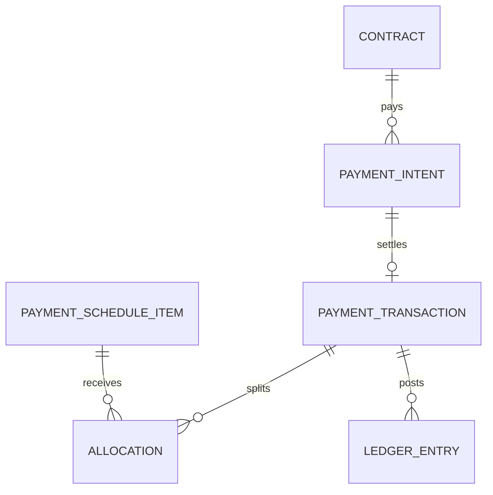

# R1e Payment Verify + Allocate Design

**Date:** 2026-11-12  
**Status:** Approved — awaiting implementation plan  
**Parent:** R1 Installment Core  
**Depends on:** R0–R1d (ACTIVE contract + PENDING schedule items)

## Decisions

| ID | Decision |
|----|----------|
| D-032 | R1e backend payments: intent + sandbox gateway port + HMAC webhook + FIFO multi-installment allocation + simple ledger; no UI/refunds/customer auth/device recovery |
| D-033 | Allocation is FIFO by schedule `seq`; partial fill on the last touched installment; one payment may span multiple items |
| D-034 | `PaymentGatewayPort` + Sandbox adapter now; future production target **Omise/Opn** (BLOCKED without credentials); not Stripe for PromptPay-primary |
| D-035 | Merchant OWNER/STAFF create payment intents for ACTIVE contracts (customer auth deferred to R1f) |

## Goal

Enable staff to create idempotent PromptPay payment intents against ACTIVE contracts, verify sandbox webhooks by signature, and allocate succeeded amounts across one or more schedule items without double-posting on replay — unlocking R1f client payment UX later.

## Non-Goals

- Live Omise credentials / production settlement  
- Stripe as PromptPay provider  
- Customer JWT / public pay links  
- Refunds, reversals, chargebacks  
- Notifications / device recovery from payment  
- Full chart-of-accounts / SaaS billing ledger mix  
- Merchant Web / Flutter UI  

## Domain Model



### PaymentIntent

- `id`, `tenantId`, `contractId`, `amount` DECIMAL(18,2), `currency` THB  
- `idempotencyKey` (unique per tenant)  
- `status`: `CREATED` | `AWAITING_PROVIDER` | `SUCCEEDED` | `FAILED` | `CANCELLED` | `EXPIRED`  
- `provider` (`sandbox` | future `omise`), `providerRef?`, `qrPayloadJson?`  
- `createdByUserId`, timestamps  

### PaymentTransaction

- `id`, `tenantId`, `paymentIntentId` (1:1 on success path)  
- `providerEventId` **unique** (replay key)  
- `amount`, `status` (`SUCCEEDED` in R1e happy path)  
- `rawEventJson` (redact secrets; store sandbox payload)  
- `verifiedAt`, timestamps  

### Allocation

- `id`, `tenantId`, `paymentTransactionId`, `scheduleItemId`, `amount` DECIMAL(18,2)  
- Unique optional guard: no duplicate allocation row for same `(paymentTransactionId, scheduleItemId)`  

### LedgerEntry (simple)

- `id`, `tenantId`, `paymentTransactionId`, `domain` = `INSTALLMENT`  
- `direction` `DEBIT` | `CREDIT`, `accountCode` string, `amount` DECIMAL(18,2)  
- R1e posts exactly two entries per succeeded transaction:  
  - DEBIT `CASH_CLEARING`  
  - CREDIT `INSTALLMENT_RECEIVABLE`  
- Never share tables semantically with SaaS billing (same table OK with `domain` discriminant)

### PaymentScheduleItem (extend R1d)

- Add `amountPaid` DECIMAL(18,2) default 0  
- Extend status enum: `PENDING` | `PARTIAL` | `PAID`  
- Outstanding for item = `totalDue - amountPaid`  

## State / Flows

### Create intent

1. OWNER/STAFF + tenant scope  
2. Contract `ACTIVE`  
3. Header `Idempotency-Key` required; reuse returns existing intent  
4. `amount > 0` and `amount <= contractOutstanding` else 422  
5. Call sandbox gateway → persist intent `AWAITING_PROVIDER` + QR payload  

### Webhook verify + allocate

1. Verify HMAC with `PAYMENT_WEBHOOK_SECRET` (constant-time compare)  
2. If `providerEventId` exists → return prior result (no new allocations)  
3. In one DB transaction:  
   - Lock/load intent + contract schedule items ordered by `seq`  
   - Create `PaymentTransaction` SUCCEEDED  
   - FIFO allocate `amount` across items with outstanding > 0  
   - Update each item `amountPaid` / status PARTIAL|PAID  
   - Write two `LedgerEntry` rows  
   - Intent → `SUCCEEDED`  
4. Never trigger device restrictive actions from this path  

### FIFO allocation algorithm

```
remaining = paymentAmount
for item in scheduleItems ordered by seq where status != PAID:
  due = totalDue - amountPaid
  apply = min(remaining, due)
  if apply > 0: create Allocation; amountPaid += apply; set PARTIAL or PAID
  remaining -= apply
  if remaining == 0: break
if remaining > 0: treat as overpay → 422 at webhook/apply time (sandbox must not send overpay beyond intent amount; intent amount already capped at create)
```

Intent amount already capped at create; webhook amount must equal intent amount or reject.

## PaymentGatewayPort

```typescript
createPromptPayIntent(input: {
  tenantId: string;
  intentId: string;
  amount: string;
  currency: 'THB';
}): Promise<{ provider: 'sandbox'; providerRef: string; qrPayload: Record<string, unknown> }>;

verifyWebhookSignature(headers: Record<string, string>, rawBody: Buffer): boolean;

parseWebhookEvent(rawBody: Buffer): {
  providerEventId: string;
  providerRef: string;
  amount: string;
  status: 'SUCCEEDED' | 'FAILED';
};
```

- Sandbox signs with HMAC-SHA256 of raw body using `PAYMENT_WEBHOOK_SECRET`  
- Production `OmisePaymentAdapter` marked BLOCKED until credentials  

## API Surface (`/api/v1`)

| Method | Path | Auth | Purpose |
|--------|------|------|---------|
| POST | `/contracts/:id/payment-intents` | JWT + Idempotency-Key | Create intent |
| GET | `/payment-intents/:id` | JWT | Get intent |
| POST | `/webhooks/payments/sandbox` | HMAC only | Sandbox webhook |

## Security & Privacy

- Webhook signature mandatory; reject before any money mutation  
- Idempotency on intent key + provider event id  
- No national ID / PAN/CVV (none collected)  
- Frontend “paid” never trusted without verified webhook  
- Device locks never from this webhook path  

## Testing Requirements

- FIFO unit tests: multi-item full + partial last item  
- Idempotency-Key reuse returns same intent  
- Bad signature → no allocation  
- Webhook replay → no double allocation / ledger  
- E2E: staff create intent → signed webhook → schedule updated; B cannot read A’s intent  
- Decimal-safe money only  

## Acceptance Criteria

1. Staff can create idempotent PromptPay sandbox intent for ACTIVE contract  
2. Valid signed webhook allocates FIFO across installments  
3. Duplicate webhook does not double-post  
4. Invalid signature rejected  
5. Cross-tenant isolation on intent GET  
6. No Omise live / refund / UI / device unlock claimed  

## Follow-on

- Omise production adapter when credentials available  
- Customer App create-intent (R1f)  
- Refunds/reversals  
- Notification + device recovery evaluation on verified payment  
- Richer ledger / reconciliation reports  
