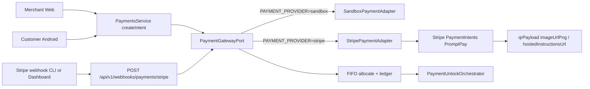

# Stripe PromptPay Lab Adapter Design

**Date:** 2026-11-22  
**Status:** Approved — implementation plan `docs/superpowers/plans/2026-11-22-stripe-promptpay-lab-adapter.md`  
**Parent:** Phase 4 payment path / R1e gateway port  
**Depends on:** R1e–R1f sandbox intents + webhooks; Phase 4a payment-to-unlock (verified SUCCEEDED only)

## Decisions

| ID | Decision |
|----|----------|
| D-034 | Unchanged: Omise/Opn remains production PromptPay-primary target; Stripe is **not** PromptPay-primary |
| D-066 (proposed) | Lab: optional `PAYMENT_PROVIDER=stripe` adapter behind `PaymentGatewayPort` for real Stripe **test-mode** PromptPay (QR + signed webhooks); sandbox remains default |

## Goal

Let staff (Merchant Web) and customers (Android) create PromptPay payment intents that settle through **Stripe test mode** using env keys `STRIPE_PUBLIC_KEY` / `STRIPE_PRIVATE_KEY`, with HMAC/signature-verified webhooks that reuse existing FIFO allocate, ledger, and payment-to-unlock — without replacing the sandbox provider or claiming live Omise.

## Non-Goals

- Stripe live mode / production settlement claims  
- Replacing Omise as PromptPay-primary (D-034)  
- Card Checkout / Payment Element as the primary lab path (PromptPay QR only in this slice)  
- Refunds, chargebacks, Connect multi-account  
- Removing sandbox adapter or forcing Stripe in CI  
- Schema redesign of PaymentIntent / Allocation  

## Architecture



- Single active gateway via `PAYMENT_PROVIDER=sandbox|stripe` (default `sandbox`).  
- Stripe adapter uses private key for create/confirm; webhook secret for `Stripe-Signature` verify.  
- `STRIPE_PUBLIC_KEY` is required when provider=stripe (boot validation / future client Elements) but this slice does not ship Stripe.js; create/confirm stays server-side (no secret in QR or apps).  

## Components

| Unit | Responsibility |
|------|----------------|
| `payment-gateway.port.ts` | Extend `PromptPayIntentResult.provider` to `'sandbox' \| 'stripe'` |
| `stripe-payment.adapter.ts` | Create+confirm PromptPay PI; verify signature; parse events → `ParsedWebhookEvent` |
| `payments-gateway.module.ts` | Factory: `sandbox` → existing; `stripe` → Stripe adapter |
| `env.validation.ts` / `.env.example` | Allow `PAYMENT_PROVIDER=stripe`; require Stripe secrets when selected |
| `payments.service.ts` | Provider-agnostic webhook handler (rename from sandbox-only naming); keep allocate/idempotency |
| `webhooks.controller.ts` | Keep `POST .../sandbox`; add `POST .../stripe` → same service handler |
| Merchant Web + Customer Android | Prefer rendering `imageUrlPng` / link `hostedInstructionsUrl` when present; still show JSON for sandbox |
| `DECISION-LOG.md` | Record D-066 |

## Env

| Variable | When required | Notes |
|----------|---------------|-------|
| `PAYMENT_PROVIDER` | always | `sandbox` (default) \| `stripe` |
| `STRIPE_PUBLIC_KEY` | when `stripe` | `pk_test_…` (required at boot; unused by PromptPay QR UI in this slice) |
| `STRIPE_PRIVATE_KEY` | when `stripe` | `sk_test_…` (server only; project already uses this name) |
| `STRIPE_WEBHOOK_SECRET` | when `stripe` | `whsec_…` from Stripe CLI **or** Dashboard endpoint |
| `STRIPE_PROMPTPAY_BILLING_EMAIL` | when `stripe` | Email for `payment_method_data.billing_details` on confirm (Stripe PromptPay requirement) |
| `PAYMENT_WEBHOOK_SECRET` | when `sandbox` | Unchanged for sandbox HMAC |

Boot fails if `PAYMENT_PROVIDER=stripe` and private/webhook secret/billing email missing.

## Data flow

### Create intent

1. Existing authz: staff JWT or customer JWT on own ACTIVE contract; `Idempotency-Key` required.  
2. Persist intent row (`CREATED`, provider placeholder), then call gateway.  
3. Stripe adapter:  
   - Amount = THB decimal → integer satang (reject non-2dp).  
   - Enforce Stripe PromptPay minimum (20 THB per current Stripe docs; fail create with 422 if below).  
   - `paymentIntents.create` with `payment_method_types: ['promptpay']`, `currency: 'thb'`, metadata `{ mipIntentId, tenantId, contractId }` (no PAN/national ID).  
   - Stripe Idempotency-Key derived from MIP intent id.  
   - `paymentIntents.confirm` with `payment_method_data: { type: 'promptpay', billing_details: { email } }`.  
   - Read `next_action.promptpay_display_qr_code`; if missing → mark intent FAILED and error.  
4. Update intent: `AWAITING_PROVIDER`, `provider=stripe`, `providerRef=pi_…`, `qrPayloadJson`:

```json
{
  "type": "promptpay",
  "provider": "stripe",
  "amount": "100.00",
  "currency": "THB",
  "imageUrlPng": "https://…",
  "imageUrlSvg": "https://…",
  "hostedInstructionsUrl": "https://…"
}
```

### Webhook

1. `POST /api/v1/webhooks/payments/stripe` with raw body (existing rawBody middleware).  
2. `verifyWebhookSignature` via Stripe constructEvent / signature header + `STRIPE_WEBHOOK_SECRET`.  
3. Handle:  
   - `payment_intent.succeeded` → `SUCCEEDED`  
   - `payment_intent.payment_failed` / `payment_intent.canceled` → `FAILED`  
   - Other types → 200 ignore  
4. `ParsedWebhookEvent`:  
   - `providerEventId` = Stripe `event.id` (`evt_…`)  
   - `providerRef` = PaymentIntent id (`pi_…`)  
   - `amount` = `(pi.amount_received \|\| pi.amount) / 100` as `"0.00"` string  
   - `status` as above  
5. Existing transactional allocate / ledger / replay by `providerEventId`; then Phase 4a unlock on SUCCEEDED when outstanding is 0.  

Lab delivery: Stripe CLI `stripe listen --forward-to …/webhooks/payments/stripe` **or** Dashboard HTTPS endpoint; both use `STRIPE_WEBHOOK_SECRET`.

## Error handling

| Case | Behavior |
|------|----------|
| Bad Stripe signature | 401; no DB writes |
| Unknown / ignored event type | 200; no allocate |
| Intent missing / wrong status / amount mismatch | Same as sandbox (404 / 409 / 422) |
| Stripe API create/confirm failure | Intent → `FAILED`; safe client error |
| Missing QR `next_action` | Intent → `FAILED` |
| Amount below PromptPay minimum | 422 before Stripe call |
| Misconfigured env for stripe | Process fail at boot |

Never treat client “I paid” or QR screenshot as settlement. Never unlock from unverified webhook.

## Client UX (minimal)

- Merchant Web contracts pay panel: if `qrPayload.imageUrlPng`, show ``; else keep JSON `<pre>` (sandbox).  
- Customer Android: show network image / open `hostedInstructionsUrl` when present; keep “paid only after webhook” copy.  
- No Stripe.js required for PromptPay QR display in this slice.  

## Testing

**Automated**

- Unit: Stripe adapter (mocked Stripe SDK) — create returns qrPayload; verify good/bad signature; parse succeeded/failed amounts.  
- Unit: `PaymentsService` with mocked gateway — allocate once, replay idempotent, bad signature, amount mismatch (reuse sandbox cases; provider=`stripe` in fixtures).  
- Regression: tenant isolation + customer cannot pay another customer’s contract.  
- Module factory: `PAYMENT_PROVIDER=stripe` selects Stripe adapter; unknown provider throws.  

**Manual lab**

1. Set `PAYMENT_PROVIDER=stripe` + test keys + webhook secret.  
2. `stripe listen --forward-to localhost:<port>/api/v1/webhooks/payments/stripe`.  
3. Staff or customer create intent ≥ 20 THB → open hosted instructions / scan test QR → succeed.  
4. Confirm intent SUCCEEDED, schedule allocation, optional unlock if balance 0 + LOCK/RESTRICT.  

## Security / PDPA

- Private key and webhook secret only in env; never in QR, git, or client bundles.  
- Webhook signature mandatory (project security standards).  
- No national ID / PAN in Stripe metadata or logs.  
- Raw Stripe event stored in `rawEventJson` without adding secrets.  

## Out of scope claims

Do not claim: production PromptPay via Stripe, live charges, Omise replacement, or Device Owner financing approval tied to this adapter.

## Exit criteria

- [ ] `PAYMENT_PROVIDER=sandbox` behavior unchanged (tests green).  
- [ ] `PAYMENT_PROVIDER=stripe` creates real test-mode PromptPay PI + QR payload.  
- [ ] Signed Stripe webhook allocates idempotently and can trigger existing unlock path.  
- [ ] `.env.example` + D-066 documented; no secrets committed.  
- [ ] Merchant Web + Customer Android can display Stripe QR/link without breaking sandbox JSON.  
